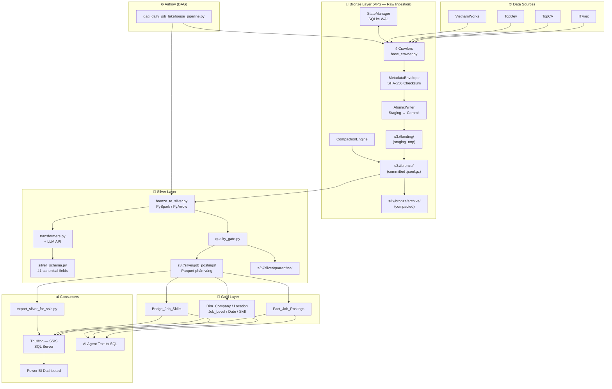

# ARCHITECTURE.md — IT Job Data Lakehouse

---

## 1. Sơ đồ kiến trúc tổng thể



---

## 2. Các layer & module chính

### 🥉 Bronze Layer `[CONFIRMED]`

| Module | File | Trách nhiệm |
|---|---|---|
| `BaseCrawler` | `src/crawlers/base_crawler.py` | Abstract base: acquire lock → fetch → envelope → write atomic → commit state |
| `ITViecCrawler` | `src/crawlers/itviec_crawler.py` | Scrape ITViec (HTML parse) |
| `TopCVCrawler` | `src/crawlers/topcv_crawler.py` | Scrape TopCV (API + HTML) |
| `TopDevCrawler` | `src/crawlers/topdev_crawler.py` | Scrape TopDev (API JSON) |
| `VietnamWorksCrawler` | `src/crawlers/vietnamworks_crawler.py` | Scrape VietnamWorks (API) |
| `StateManager` | `src/storage/state_manager.py` | SQLite WAL — watermark, run audit, compaction audit, stale lease recovery |
| `MetadataEnvelope` | `src/storage/metadata_envelope.py` | Bọc `_metadata` + `raw_payload` + `_rescued_data` + SHA-256 |
| `AtomicWriter` | `src/storage/atomic_writer.py` | Ghi MinIO: staging `.tmp` → verify manifest → commit rename |
| `CompactionEngine` | `src/storage/compaction_engine.py` | Gộp file nhỏ → archive; retention lifecycle |

### 🥈 Silver Layer `[INFERRED — đang xây dựng]`

| Module | File | Trách nhiệm |
|---|---|---|
| `bronze_to_silver` | `src/etl/bronze_to_silver.py` | PySpark đọc Bronze → transform → write Parquet Silver |
| `quality_gate` | `src/etl/quality_gate.py` | Kiểm tra mandatory fields, salary outliers, quarantine rate |
| `transformers` | `src/etl/transformers.py` | Normalize lương, skill taxonomy, company name, temporal fields |
| `SilverSchema` | `src/schemas/silver_schema.py` | 41 canonical fields (PyArrow schema) |

### ⚙️ Utilities

| Module | File | Trách nhiệm |
|---|---|---|
| `MinioClient` | `src/utils/minio_client.py` | Singleton MinIO client wrapper |
| `BronzeAuditReporter` | `src/utils/bronze_audit_reporter.py` | Deep audit: manifest verify + SHA-256 recheck |
| `BackupBronze` | `src/utils/backup_bronze.py` | Backup/restore Bronze bucket với `verify_backup_drill()` |
| `ExportSilverForSSIS` | `src/utils/export_silver_for_ssis.py` | Xuất Silver → CSV cho Thưởng/SSIS |

---

## 3. Luồng dữ liệu chi tiết — Bronze Ingestion

```
1. Crawler.run(mode="incremental")
   └─ StateManager.acquire_run_lock()          ← INSERT-FIRST atomic, partial unique index
      └─ [BLOCKED nếu source đang RUNNING]
   └─ StateManager.get_watermark()             ← Lấy last_watermark_ts, last_record_id
   └─ fetch_jobs(mode, max_pages, watermark)   ← HTTP requests với early stopping
      └─ self.heartbeat() mỗi trang            ← Dual-phase heartbeat (fetch phase)
   └─ MetadataEnvelope.wrap(raw_record)        ← Thêm _metadata, SHA-256
   └─ AtomicWriter.write_batch(generator)
      └─ Ghi vào landing/staging/{run_id}.tmp  ← Accumulate
      └─ self.heartbeat() mỗi 10 records       ← Dual-phase heartbeat (write phase)
      └─ Tính SHA-256 manifest của file
      └─ MinIO PUT .jsonl.gz vào bronze/        ← Commit
      └─ Verify manifest sau PUT               ← Fail-closed nếu mismatch
   └─ StateManager.commit_run()                ← Cập nhật watermark, status=SUCCESS
```

---

## 4. Storage layout MinIO `[CONFIRMED]`

```
s3://landing/
  staging/{run_id}.tmp                        ← Xóa tự động sau 7 ngày (Lifecycle)

s3://bronze/
  {source_name}/
    ingest_year={YYYY}/ingest_month={MM}/ingest_day={DD}/
      part_{source}_{mode}_{timestamp}_{short_uuid}.jsonl.gz
  archive/                                    ← File cũ sau compaction (Audit Trail)

s3://silver/
  job_postings/
    platform={platform}/posted_date={date}/   ← Hive-style partition
      *.parquet
  quarantine/                                 ← Records bị loại bởi Quality Gate
```

---

## 5. SQLite State Store Schema `[CONFIRMED]`

```sql
-- Watermark và trạng thái gần nhất của mỗi source
CREATE TABLE ingestion_state (
    source_name       TEXT PRIMARY KEY,
    last_watermark_ts TEXT,
    last_record_id    TEXT,
    last_run_status   TEXT,
    records_ingested  INTEGER DEFAULT 0,
    updated_at        TEXT
);

-- Audit trail toàn bộ phiên chạy
CREATE TABLE ingestion_runs (
    run_id           TEXT PRIMARY KEY,
    source_name      TEXT NOT NULL,
    mode             TEXT NOT NULL,       -- 'full' hoặc 'incremental'
    started_at       TEXT NOT NULL,
    finished_at      TEXT,
    status           TEXT NOT NULL,       -- RUNNING, SUCCESS, FAILED
    records_ingested INTEGER DEFAULT 0,
    bronze_s3_uri    TEXT,
    duration_sec     REAL DEFAULT 0.0,
    error_message    TEXT,
    process_id       INTEGER,
    heartbeat_at     TEXT
);
-- KHÓA CHỐNG TRÙNG TIẾN TRÌNH:
CREATE UNIQUE INDEX idx_active_running_per_source
ON ingestion_runs(source_name) WHERE status = 'RUNNING';

-- Audit log sau mỗi lần compaction
CREATE TABLE compaction_audit_logs (...);
```

---

## 6. Quyết định kiến trúc đã chốt

| Quyết định | Lý do |
|---|---|
| SQLite WAL thay vì file JSON state | ACID + đọc đồng thời non-blocking + partial unique index |
| Insert-First pattern (không Select-then-Insert) | Tránh race condition TOCTOU giữa 2 tiến trình OS |
| Staging `.tmp` → verify → commit rename | Fail-closed: không bao giờ có file nửa chừng trong bronze/ |
| `ingest_time` partitioning (không `posted_date`) | Source không đáng tin với posted_date; ingestion time luôn có |
| JSONL + gzip thay vì Parquet ở Bronze | Schema-on-read — không ép kiểu raw, bảo toàn 100% dữ liệu gốc |
| Dual-phase heartbeat (fetch + write) | Phát hiện stale lease cả khi mạng chậm lẫn khi ghi lớn |

---

## Open Questions

- `[UNCONFIRMED]` Silver layer dùng Delta Lake hay plain Parquet + overwrite partition?
- `[TODO]` Airflow: local hay Celery executor? Scheduler interval?
- `[NEEDS_CONFIRMATION]` Port MinIO trên VPS: đã bind `127.0.0.1:9000` hay vẫn `0.0.0.0:9000`?

